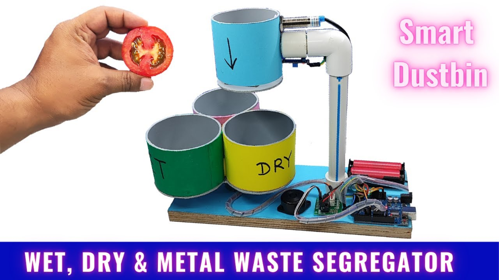
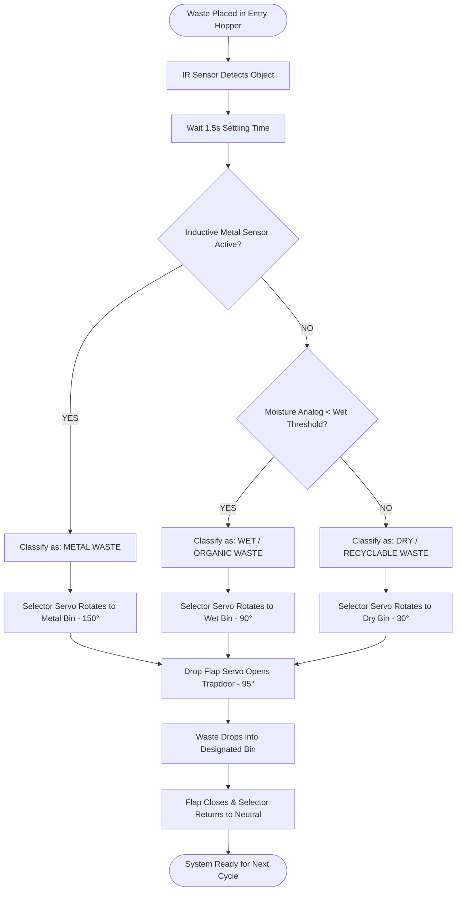

# 🗑️ Automatic Waste Segregation Bin (Smart Dustbin)

[](LICENSE)
[](https://www.arduino.cc/)
[](https://isocpp.org/)
[]()
[](CONTRIBUTING.md)

> An automated, sensor-driven embedded waste management system that detects, classifies, and segregates municipal and domestic waste into **Dry**, **Wet (Organic)**, and **Metallic** categories right at the point of disposal using sensor fusion and precision servo actuation.

---

## 📸 Physical Prototype Showcase

<div align="center">
  
  <p><em>Figure 1: Working 3-Compartment Smart Segregator Prototype featuring Intake Hopper, Proximity Sensors, Dual Servos, and Arduino Uno.</em></p>
</div>

---

## 🌟 Key Features & Engineering Design

- **Multi-Sensor Fusion**: Combines an **Inductive Proximity Sensor**, **Resistive Moisture Sensor**, and **Infrared (IR) Sensor** for rapid, automated material classification.
- **Hierarchical Priority Classification**: Intelligently prioritizes metal detection before moisture analysis to avoid misclassifying wet metallic cans.
- **Dual-Servo Automated Routing**:
  - **Selector Servo**: Rotates the discharge chute or carousel to align directly with the designated compartment.
  - **Drop Flap Servo**: Actuates the chamber trapdoor to release waste cleanly under gravity.
- **Finite State Machine (FSM) Firmware**: Prevents race conditions, jitter, and unexpected resets.
- **Analog Noise Filtering**: 10-sample moving average filter on moisture readings eliminates false positives from static charge and erratic surface contact.
- **Audio-Visual Indicators**: Dynamic buzzer tone sequences and multi-color LED indicators signal system states and real-time classification decisions.

---

## ❓ Problem Solved by the Project

In traditional waste disposal, all types of waste—such as food scraps, paper, plastic, and beverage cans—are thrown into a common bin. 

1. **Hygiene & Safety**: Sanitation workers must separate waste manually, exposing them to pathogens, sharp metals, and toxic chemical leachates.
2. **Loss of Recyclability**: Organic wet waste degrades dry paper and cardboard, making clean recycling difficult or impossible.
3. **Automated Solution**: This project automates separation directly at the point of disposal. Waste is classified immediately upon insertion and directed into its respective compartment before cross-contamination can occur.

---

## ⚙️ How It Works (Working Principle)



1. **Detection**: An object is placed into the upper collection hopper and detected by an IR proximity sensor.
2. **Settling**: The system pauses for 1.5 seconds to allow the item to come to a complete rest on the sensing platform.
3. **Classification**:
   - **Metal Check**: If the inductive sensor triggers, the waste is marked as **Metal**.
   - **Moisture Check**: If metal is absent, the analog moisture sensor reads conductivity. Readings below the threshold indicate **Wet / Organic Waste**.
   - **Dry Waste Default**: Non-metallic, low-conductivity items (paper, cardboard, plastic) are classified as **Dry Waste**.
4. **Segregation & Actuation**:
   - The selector servo turns the guide chute to the target container.
   - The drop flap servo opens the trapdoor, allowing the item to fall cleanly.
   - The trapdoor closes, and the selector servo returns to standby.

---

## 🛠️ Hardware Components & Specifications

| Component | Specification | Quantity | Function |
| :--- | :--- | :---: | :--- |
| **Microcontroller** | Arduino Uno R3 (ATmega328P) | 1 | Processes sensor signals and coordinates servo movements |
| **Metal Sensor** | LJ12A3-4-Z/BX Inductive Proximity (NPN NO) | 1 | Detects metallic objects in the intake chamber |
| **Moisture Sensor** | Resistive Soil/Raindrop Conductivity Probe | 1 | Measures moisture/water content to detect wet waste |
| **Object Sensor** | Active-Low IR Obstacle Proximity Module | 1 | Detects the entry of waste into the hopper |
| **Chute Actuator** | MG995 / TowerPro SG90 Servo | 1 | Aligns the chute to Dry (30°), Wet (90°), or Metal (150°) |
| **Flap Actuator** | TowerPro SG90 Micro Servo | 1 | Opens and closes the chamber trapdoor |
| **Audio Feedback** | 5V Piezo Buzzer | 1 | Provides distinct audio tones for each waste type |
| **Visual Indicators**| 5mm LEDs (Green, Yellow, Red, Blue) + 220Ω | 4 | Indicates power, busy state, and classified waste type |
| **Power Supply** | 2x 18650 Li-ion Batteries (7.4V) + Buck Converter | 1 | Provides stable power for both the microcontroller and servos |
| **Structure** | PVC Pipe Arm, Cylindrical Hoppers, Wooden Baseboard | 1 | Physical frame and waste holding compartments |

---

## 🔌 Pin Mapping & Wiring Overview

| Sensor / Module | Signal Pin | Arduino Pin | Description |
| :--- | :--- | :--- | :--- |
| **IR Proximity Sensor** | OUT | `D2` | Waste entry trigger |
| **Inductive Metal Sensor** | Black (Signal) | `D3` | Metal detection |
| **Moisture Sensor** | A0 (Analog) | `A0` | Conductivity reading (0 = Wet, 1023 = Dry) |
| **Moisture Sensor** | D0 (Digital) | `D4` | Hardware threshold trigger (optional) |
| **Selector Servo** | PWM Signal | `D9` | 3-way chute alignment |
| **Drop Flap Servo** | PWM Signal | `D10` | Hopper trapdoor actuator |
| **Piezo Buzzer** | Positive (+) | `D6` | System audio alerts |
| **Metal Indicator LED**| Anode (+) | `D5` | Metal waste status indicator |
| **Wet Indicator LED** | Anode (+) | `D7` | Wet waste status indicator |
| **Dry Indicator LED** | Anode (+) | `D8` | Dry waste status indicator |

> 📖 **Wiring & Electrical Details:** See [docs/CIRCUIT_DIAGRAM.md](docs/CIRCUIT_DIAGRAM.md)

---

## 📂 Repository Structure

```
Automatic-Waste-Segregation-Bin/
│
├── assets/
│   └── project_prototype.png          # Visual photograph of physical hardware build
│
├── docs/
│   ├── CIRCUIT_DIAGRAM.md             # Complete wiring tables, power distribution & isolation
│   ├── CALIBRATION_GUIDE.md           # Sensor threshold tuning and servo angle calibration
│   └── IOT_EXPANSION_GUIDE.md         # ESP32 / Blynk cloud telemetry & smart city integration
│
├── src/
│   ├── automatic_waste_segregator/
│   │   ├── automatic_waste_segregator.ino  # Production firmware with Finite State Machine
│   │   └── config.h                        # Pin mappings, servo angles, and threshold constants
│   │
│   └── sensor_calibration/
│       └── sensor_calibration.ino          # Diagnostic benchmark tool for live sensor logging
│
├── .gitignore
├── CONTRIBUTING.md
├── LICENSE
└── README.md
```

---

## 🚀 Setup & Execution Guide

### 1. Requirements
- [Arduino IDE](https://www.arduino.cc/en/software)
- Arduino Uno / Nano connected via USB
- Built-in `Servo.h` library

### 2. Flashing the Firmware
1. Clone this repository:
   ```bash
   git clone https://github.com/sujaypaul27/Automatic-Waste-Segregation-Bin.git
   cd Automatic-Waste-Segregation-Bin
   ```
2. Open `src/automatic_waste_segregator/automatic_waste_segregator.ino` in the Arduino IDE.
3. Select your board from **Tools > Board > Arduino Uno** (or Nano).
4. Select the corresponding port from **Tools > Port**.
5. Click **Upload** (Ctrl + U).

### 3. Operating the Bin
1. Open the Serial Monitor (**Tools > Serial Monitor**) at **9600 baud**.
2. Drop an item into the top intake hopper.
3. The system detects the item, samples the sensors, announces the classification over the serial monitor, and actuates the servos to drop the item into the matching bin.

---

## ⚙️ Calibration

Sensor threshold values and servo angles can be customized in [`src/automatic_waste_segregator/config.h`](src/automatic_waste_segregator/config.h):
- `MOISTURE_WET_THRESHOLD`: Adjust to calibrate the sensitivity boundary between wet and dry items.
- `ANGLE_BIN_DRY`, `ANGLE_BIN_WET`, `ANGLE_BIN_METAL`: Adjust to align with your physical bin layout.

> 📖 **Step-by-step calibration guide:** See [docs/CALIBRATION_GUIDE.md](docs/CALIBRATION_GUIDE.md)

---

## 🔮 Future Scope & Improvements

- **Capacitive Proximity Sensor**: To identify non-metallic materials such as pure plastic vs paper.
- **Ultrasonic Level Detection**: To track the fill-level of each compartment and signal when full.
- **IoT Cloud Dashboard**: Wi-Fi connectivity via ESP32/ESP8266 to upload bin status to a municipal monitoring interface.

---

## 👨‍💻 Author

**Sujay Paul**
- GitHub: [@sujaypaul27](https://github.com/sujaypaul27)
- Repository: [Automatic-Waste-Segregation-Bin](https://github.com/sujaypaul27/Automatic-Waste-Segregation-Bin)

---

## 📄 License

This project is licensed under the [MIT License](LICENSE).
